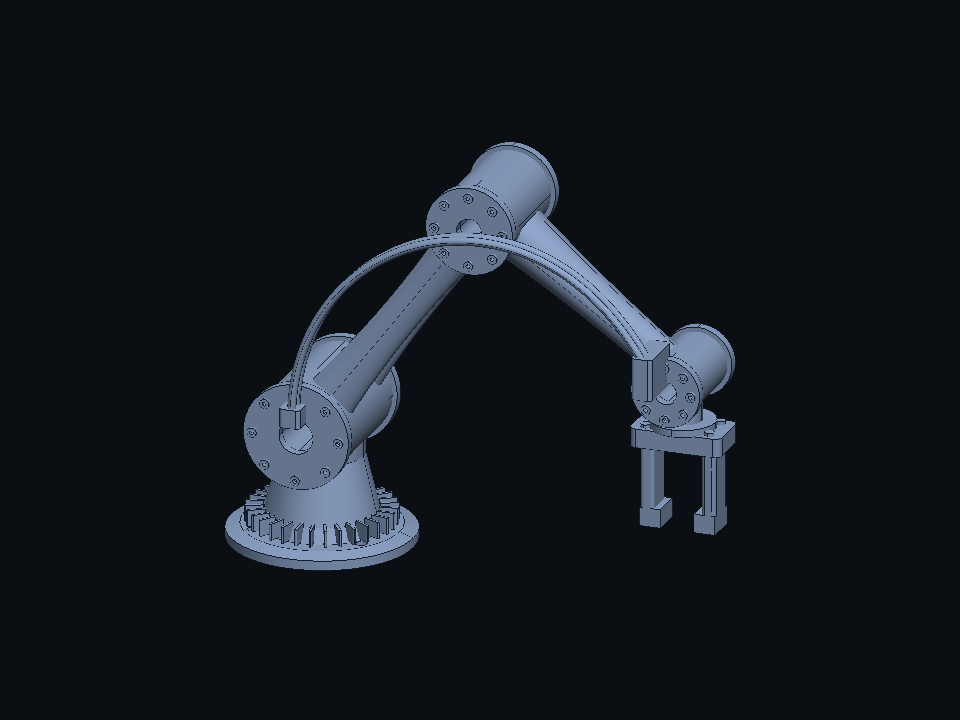
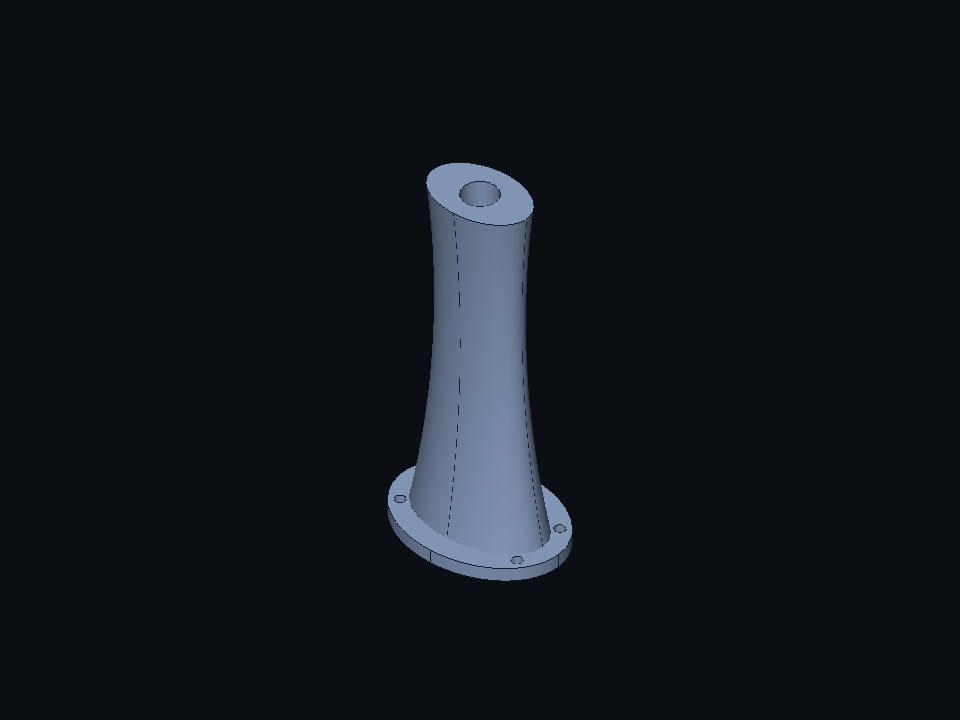
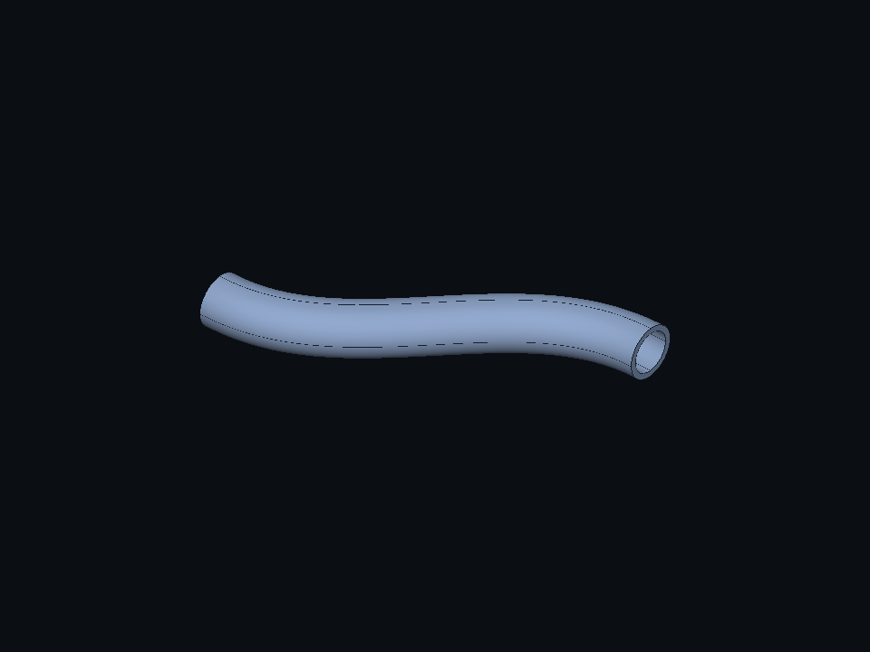

# Modeling showcases

## Nocturne manipulator



[nocturne.nightfall](nocturne.nightfall) combines 71 authored features into 21 live bodies
and 106 closed solids: a turned/drilled pedestal, 32 rounded cooling fins, three drilled
joint housings with 48 mirrored socket heads, twin elliptic upper-link lofts, a tapered
forearm loft, two cubic-spline harness runs with mounting blocks, and a rounded, drilled
gripper with two hooked jaws. Its seven parameters control link lengths, shoulder height,
waist scale, jaw gap, fin count and cable radius. This is a posed multibody geometry model;
assembly constraints, motion, collision, actuators and load/strength analysis are unverified.

The authored shoulder/elbow/wrist centers are (0,0,110), (150,0,310) and (318,0,184) mm.
Fixed orthogonal section frames set the pose; these placements are not solved robot joints.
The summed component volume is 2408145.026752167 mm³ and area 390313.091946063 mm². The display
has 201808 triangles. Every component family's volume has an independent primitive,
frustum, quadratic-section or positive Bezier-length integral oracle, with 1e-5 mm³
absolute tolerance (1e-3 for swept harnesses). The exact STEP round-trip retains all 106
solids, and indexed-mesh volume differs by less than 1%.

The actual native test builds the full model, changes `link_waist` to 0.95 and `jaw_gap`
to 34 mm together, checks a changed render, then undoes to byte-identical clean source and
original component measurements. The image above is the real Metal render. Current source
builds include **Examples → Nocturne**; preview 0.0.10 can open the saved part with **Open…**.
The local `out/Nightfall-Nocturne.json` companion has identical source bytes.

```sh
build/occt/tools/cli/nf build examples/modeling/nocturne.nightfall --out out/Nightfall-Nocturne.step
ctest --preset occt -R 'Nocturne|^bundle.nocturne$' -V
```

This geometry-only showcase advances [#169](https://github.com/wckdboy/nightfall/issues/169);
it does not complete the verified robotic-arm milestone. Review/evidence:
[#183](https://github.com/wckdboy/nightfall/issues/183).

## Asterion cooling module


Preview 0.0.7 opens Asterion by default; choose **Examples → Asterion** to reopen it.
Use each body's eye button to hide/show it, the viewfinder to isolate it, and **Show all
bodies** to restore the complete model. Visibility affects the viewport only and resets
when another document opens; source, mass measurements and Undo history stay unchanged.
The source is [asterion.nightfall](asterion.nightfall): 28 features, eight live bodies and
80 closed solids, including 64 individually rounded fins, a turned hub, a drilled rounded
mount, mirrored stands, a guard ring and chamfered fasteners. These are exact B-rep solids;
the model has no assembly joints, materials, thermal analysis or simulation results.

Edit `fin_count`, `fin_height`, `fin_radius` or `module_count`, then press Return. The
single module is the default for visual inspection. Larger arrays deliberately stress
the current engine and can exceed the native service's five-second deadline.
An eight-module variant (640 solids / 217,142 triangles) was successfully displayed in
the native client after #162; this is a measured case, not a guaranteed maximum.
After #167's surface-area integration improvement, three actual XPC/client/Metal rebuilds
complete locally in about 2.4 seconds each, including rendering and clean Undo validation.
The watchdog remains five seconds; machine load and geometry still affect success.
The extracted 0.0.7 app displayed 1→8 and 8→4 edits, but a subsequent 4→8 edit hit the
watchdog and kept marked last-valid geometry. Undo restored the clean original. Reliable
GUI variant sequences remain follow-up [#171](https://github.com/wckdboy/nightfall/issues/171).

```sh
build/occt/tools/cli/nf build examples/modeling/asterion.nightfall --out out/asterion.step
build/occt/tools/cli/nf build examples/modeling/asterion.nightfall --set module_count=8 --out out/asterion-array.step
build/occt/services/kernel/nf_showcase_bench examples/modeling/asterion.nightfall 5
```

The developer benchmark emits JSON lines with cold rebuild, warm rebuild, indexed-mesh
and C-bridge times. It uses the same 96-entry / 64 MiB estimated geometry cache and default
0.1 mm / 0.2 rad display settings as the service. It does not include XPC, client decoding,
GPU upload or rendering; C-bridge measurements include rebuild, meshing and manifest encoding.
Run it on a quiet machine, retain the output and distinguish medians from worst cases.

The private native probe also measures actual service round trips and manifest/display
conversion separately (first request is model-cold after service startup):

```sh
build/occt/app/tests/nf_xpc_probe.app/Contents/MacOS/nf_xpc_probe benchmark out/Nightfall-Asterion-8-modules.nightfall 3
ctest --preset occt -R '^bundle.scalability$' -V
```

The stress input under `out/` is a local copy with `module_count` set to eight. The native
integration test generates its edit from the checked-in example and renders all eight
modules and isolated fins, checks exact component mass scaling, then undoes to the original.

Regression tests integrate each component's primitive/frustum mass independently, exercise
parameter edits and cache reuse, reload exported STEP, and compare mesh volume within 1%.
Exact volume and area checks use an absolute tolerance of 1e-5 in mm units. The original
20 reference-part baselines remain unchanged.

[Rounded Plate](rounded_plate.nightfall) is a smaller example for exact corner fillets.

## Lofted actuator link



Preview 0.0.8 includes **Examples → Lofted Link**, from
[lofted_link.nightfall](lofted_link.nightfall). Three exact elliptic sections form a smooth
housing joined to a mounting flange, with a central bore and four through mounting holes.
Edit `height`, `waist_scale`, `bore_radius` or `flange_thickness`; the native client supports
batch rebuild, Undo, suppression and marked last-valid display on failure. This is geometry
for exploring the robotic-arm milestone, without motion, strength or actuator validation.

Default independent values are V = 160612.8772172270 mm³, A = 35752.4962832179 mm² and
centroid z = 59.6972498598 mm. The actual native display has 8934 triangles. Analytic
quadratic-section integration and independent surface-metric quadrature check mass within
1e-5 absolute tolerance; STEP reload and the indexed mesh are also checked. The screenshot
comes from the real XPC/client/Metal test and has been visually inspected.

```sh
build/occt/tools/cli/nf build examples/modeling/lofted_link.nightfall --out out/lofted-link.step
build/occt/tools/cli/nf build examples/modeling/lofted_link.nightfall --set waist_scale=1.1 --out out/lofted-link-wide.step
ctest --preset occt -R '^bundle.lofts$' -V
```

The initial loft supports 2..32 closed sections on parallel, strictly ordered planes, one
filled region without holes per section. Two sections interpolate linearly; additional
sections interpolate smoothly with uniform section parameters and maximum longitudinal
degree three. Guide rails, point sections and nonparallel planes report errors. Flat sides
represented as NURBS remain NURBS; plane selectors require analytic planes. Interactive
spline control-point editing remains a follow-up.

## Swept spline conduit



Preview 0.0.9 includes **Examples → Swept Conduit**, from
[swept_conduit.nightfall](swept_conduit.nightfall). A cubic spline with an inflection carries
the outer circle and the through-bore cut, producing one hollow solid. Edit `reach`, `lift`,
`radius` or `wall`, then press Return. This is a geometry prototype, without flow, strength
or motion validation. Both humans and headless clients use the same v1 document and kernel.

Independent centerline integration gives length 212.2747402664 mm, V = 50016.0573422607 mm³
and A = 33815.2771262122 mm² at the defaults. Tests check mass and area within 1e-3 absolute
tolerance at two parameter settings. The actual XPC/Metal test renders both variants,
verifies clean Undo, bore suppression, invalid-parameter last-valid recovery and unchanged
source bytes. The screenshot is its actual native render, visually inspected.

```sh
build/occt/tools/cli/nf build examples/modeling/swept_conduit.nightfall --out out/swept-conduit.step
ctest --preset occt -R '^bundle.sweeps$' -V
```

Initial sweeps use one profile region without holes and one whole open sketch line, arc or
spline as the path. The profile origin/normal matches the forward path start/tangent. The
path's plane normal is a fixed binormal, preserving authored profile roll through an
inflection. Corners, closed/spatial/selector paths and uncertified path spans report errors;
the backend contract and work bounds are documented in `IKernel::sweep`.

Measured on local arm64 builds, 2026-10-19: the native client displayed eight modules
(640 solids / 512 fins / 217,142 triangles). The headless evaluator and indexed mesher
completed a 6×6 grid (2,880 solids / 976,966 triangles); cold rebuild took 18.130 s and
meshing 4.936 s in one sample. Its benchmark exceeded the 45 s total timeout before
completing C-bridge measurement. A 7×6 grid reaches the one-million-triangle display
budget. These are tested cases, not a universal maximum, guaranteed latency or FPS claim.
Larger headless source inputs are retained as `out/Nightfall-Asterion-6x6.nightfall` and
`out/Nightfall-Asterion-7x6.nightfall`; use the CLI for models beyond the native deadline.
