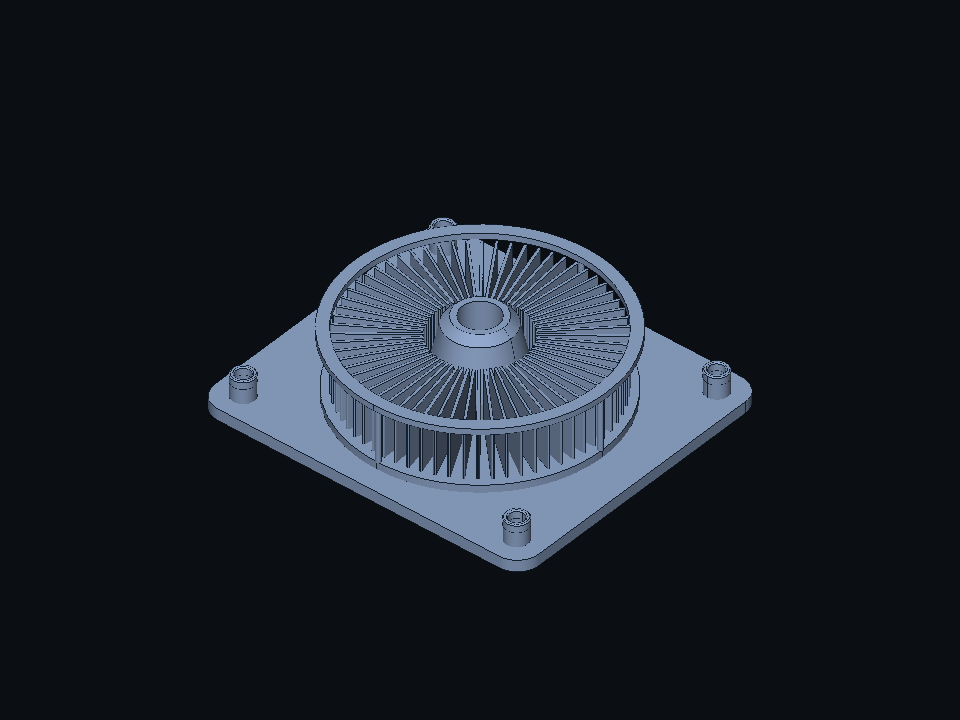

# Modeling showcases



Preview 0.0.7 opens Asterion by default; choose **Examples → Asterion** to reopen it.
Use each body's eye button to hide/show it, the viewfinder to isolate it, and **Show all
bodies** to restore the complete model. Visibility affects the viewport only and resets
when another document opens; source, mass measurements and Undo history stay unchanged.
The source is [asterion.nightfall](asterion.nightfall): 28 features, eight live bodies and
80 closed solids, including 64 individually rounded fins, a turned hub, a drilled rounded
mount, mirrored stands, a guard ring and chamfered fasteners. These are exact B-rep solids;
the model has no assembly joints, materials, thermal analysis or simulation results.

Edit `fin_count`, `fin_height`, `fin_radius` or `module_count`, then press Return. The
single module is the default for visual inspection. Larger arrays deliberately stress
the current engine and can exceed the native service's five-second deadline.
An eight-module variant (640 solids / 217,142 triangles) was successfully displayed in
the native client after #162; this is a measured case, not a guaranteed maximum.
After #167's surface-area integration improvement, three actual XPC/client/Metal rebuilds
complete locally in about 2.4 seconds each, including rendering and clean Undo validation.
The watchdog remains five seconds; machine load and geometry still affect success.

```sh
build/occt/tools/cli/nf build examples/modeling/asterion.nightfall --out out/asterion.step
build/occt/tools/cli/nf build examples/modeling/asterion.nightfall --set module_count=8 --out out/asterion-array.step
build/occt/services/kernel/nf_showcase_bench examples/modeling/asterion.nightfall 5
```

The developer benchmark emits JSON lines with cold rebuild, warm rebuild, indexed-mesh
and C-bridge times. It uses the same 96-entry / 64 MiB estimated geometry cache and default
0.1 mm / 0.2 rad display settings as the service. It does not include XPC, client decoding,
GPU upload or rendering; C-bridge measurements include rebuild, meshing and manifest encoding.
Run it on a quiet machine, retain the output and distinguish medians from worst cases.

The private native probe also measures actual service round trips and manifest/display
conversion separately (first request is model-cold after service startup):

```sh
build/occt/app/tests/nf_xpc_probe.app/Contents/MacOS/nf_xpc_probe benchmark out/Nightfall-Asterion-8-modules.nightfall 3
ctest --preset occt -R '^bundle.scalability$' -V
```

The stress input under `out/` is a local copy with `module_count` set to eight. The native
integration test generates its edit from the checked-in example and renders all eight
modules and isolated fins, checks exact component mass scaling, then undoes to the original.

Regression tests integrate each component's primitive/frustum mass independently, exercise
parameter edits and cache reuse, reload exported STEP, and compare mesh volume within 1%.
Exact volume and area checks use an absolute tolerance of 1e-5 in mm units. The original
20 reference-part baselines remain unchanged.

[Rounded Plate](rounded_plate.nightfall) is a smaller example for exact corner fillets.

Measured on local arm64 builds, 2026-10-19: the native client displayed eight modules
(640 solids / 512 fins / 217,142 triangles). The headless evaluator and indexed mesher
completed a 6×6 grid (2,880 solids / 976,966 triangles); cold rebuild took 18.130 s and
meshing 4.936 s in one sample. Its benchmark exceeded the 45 s total timeout before
completing C-bridge measurement. A 7×6 grid reaches the one-million-triangle display
budget. These are tested cases, not a universal maximum, guaranteed latency or FPS claim.
Larger headless source inputs are retained as `out/Nightfall-Asterion-6x6.nightfall` and
`out/Nightfall-Asterion-7x6.nightfall`; use the CLI for models beyond the native deadline.
